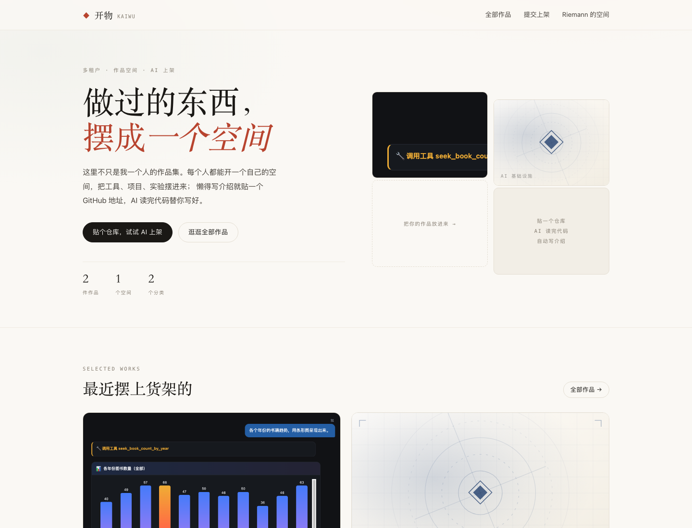
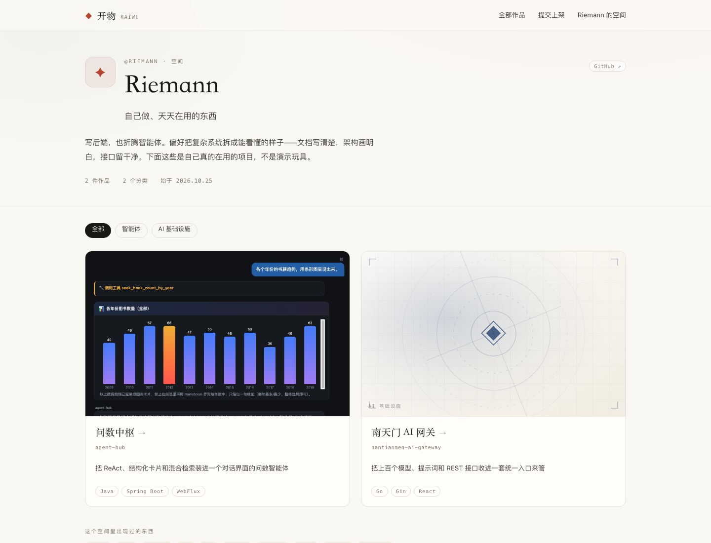
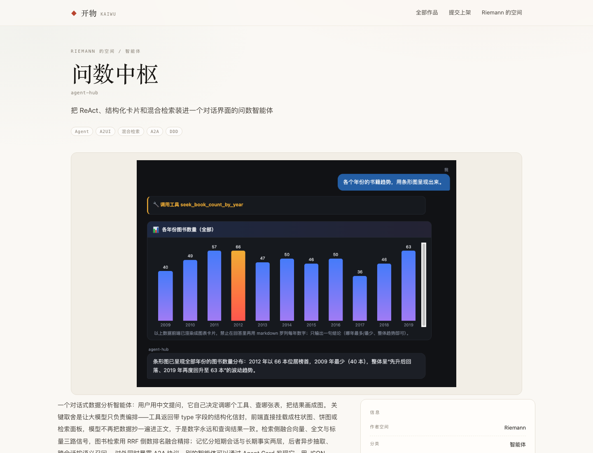
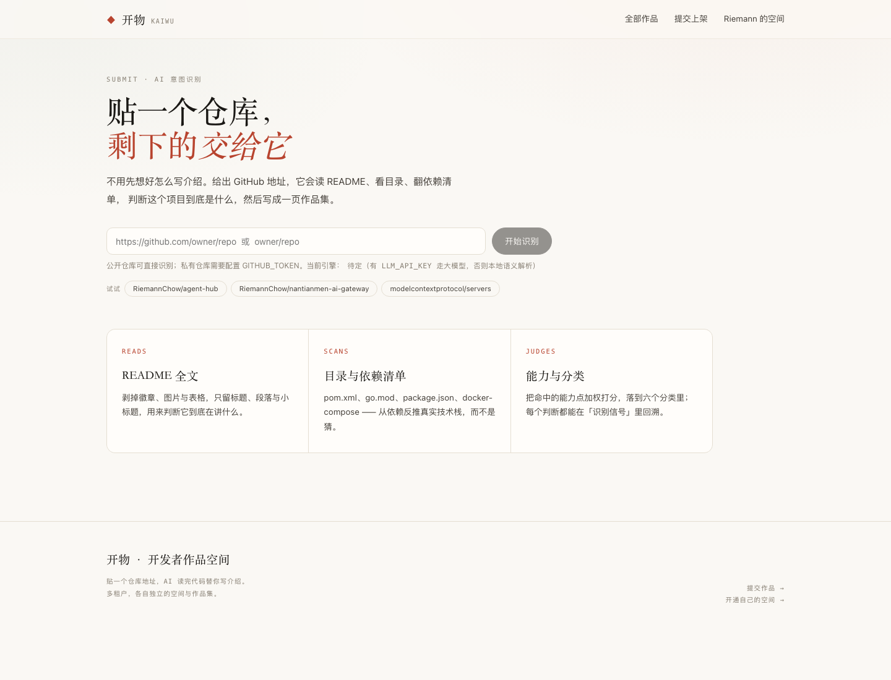
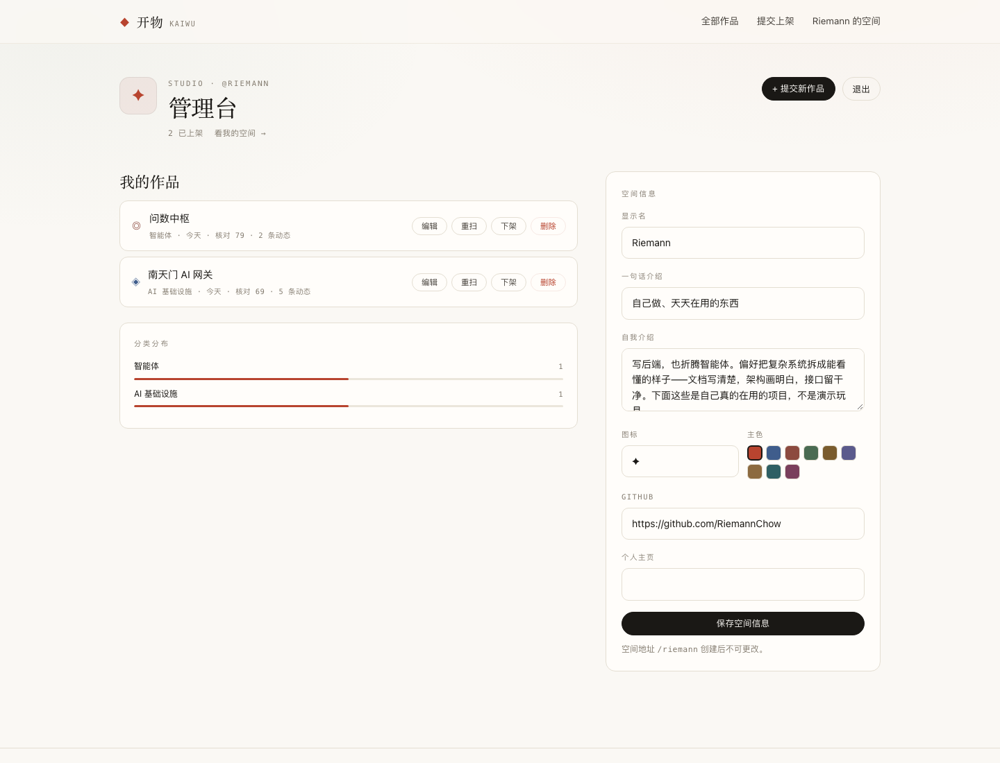
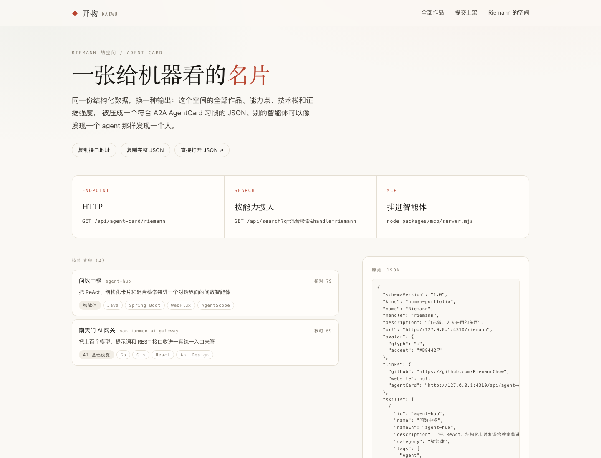
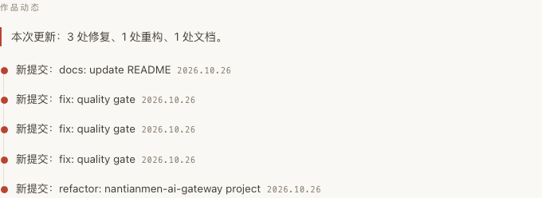
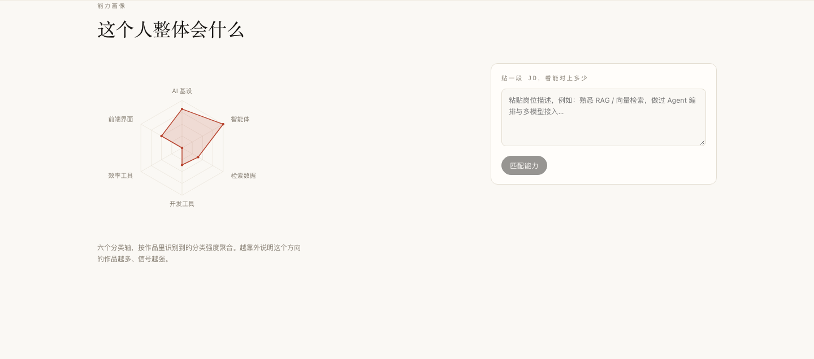
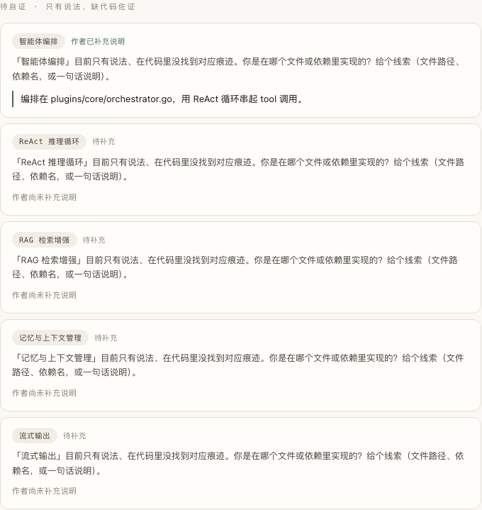

> 📖 中文文档: [README.zh.md](./README.zh.md)

# Kaiwu 开物

A multi-tenant developer portfolio platform. Everyone gets their own space to showcase projects; too lazy to write a description? Just paste a GitHub URL and AI reads the repo and writes the card for you.

The visual and information structure take inspiration from [product.yao-yang.cn](https://product.yao-yang.cn/), but this version turns a "personal portfolio" into a "multi-tenant platform + AI onboarding pipeline".

---

## Getting Started

```bash
npm install
npm run dev          # http://localhost:4310
```

The site starts empty. To see two people's portfolios right away, open another terminal:

```bash
npm run seed         # requires dev to be running
```

`seed` runs the real recognition pipeline against `RiemannChow/agent-hub` and `RiemannChow/nantianmen-ai-gateway`, then publishes them to the `@riemann` space.

## Configure an LLM (optional)

Works without any config — it falls back to the built-in local semantic engine. With a key, it uses an upstream model for more natural copy:

```bash
cp .env.example .env
# fill in LLM_API_KEY / LLM_BASE_URL / LLM_MODEL (any OpenAI-compatible endpoint)
```

Also recommended: set `GITHUB_TOKEN`, otherwise the unauthenticated GitHub API is rate-limited to 60 calls/hour (one recognition consumes ~3-6).

---

## Screenshots

| Home | Space portfolio |
| --- | --- |
|  |  |

| Project detail | AI onboarding |
| --- | --- |
|  |  |

| Studio | Agent Card |
| --- | --- |
|  |  |

---

## Three Innovations

### 1. Claim vs. Evidence Check

The bottom of the detail page adds a "Check" panel that splits **claims** from the README against **evidence** found in the code:

- **Verified** — claimed in README and found in code (e.g. `package.json` actually has the `mcp` dependency)
- **Questionable** — claimed in README but no trace in code
- **Missing** — present in code but never mentioned in the README (e.g. a Dockerfile exists while docs say nothing)

Each capability links to its evidence source (filename or dependency path), so users can see at a glance whether "AI says I do MCP" is actually true. A check score `(Verified×3 + Missing×2) / max` is printed directly on the card.

Implementation splits analysis into two streams: `claimCorpus` (README + topics + description) and `evidenceCorpus` (file tree + dependency list), each run through its own hit rules then cross-compared. In `lib/analyze/rules.ts` every capability carries an `evidence` field describing where to look.

### 2. Living Cards (rescan + activity)

A project is not a snapshot frozen at publish time. Each card in the Studio gets a "Rescan" button that, when clicked:

1. Re-runs the analysis pipeline (fetches latest repo info, including recent commits)
2. Computes a structured diff vs. the last scan (commits, capabilities, tech stack, stars, license — not the generated Chinese copy)
3. Produces a changelog: `new commits`, `capability added / evidence filled in`, `tech stack added`, `star up/down`…
4. Writes to `changelog`, growing a timeline at the bottom of the detail page

"New commits" is the most honest signal — it comes straight from the repo's commit list, not the detector re-reading the copy. The tech stack only reports additions, never removals, to avoid detector ordering jitter being misread as "dropped a stack".



This turns a card from "what I've done" into "what I'm doing lately", fixing the common "built once, then dead" portfolio problem.

### 3. Agent Card — a business card for machines

`/riemann/agent-card` compresses a person's entire portfolio, capabilities, and tech stack into a structured JSON, with fields aligned to the A2A AgentCard spec. It also exposes three external interfaces:

| Endpoint | Description |
| --- | --- |
| `GET /api/agent-card/:handle` | Structured JSON (skills / links / endpoints) |
| `GET /api/search?q=...` | Search people by capability keyword, supports `&handle=` to scope to a space |
| `packages/mcp/server.mjs` | MCP Server with `search_portfolio` + `publish_project` tools |

Any MCP-compatible agent can "find out what this person can do" and "help them publish a repo". A human's portfolio thus becomes a discoverable node in the agent network.

---

## Trust & Distribution Layer

On top of the three directions above, a layer was added to make the innovations actually trustworthy and shareable, prioritized by cost/benefit into three tiers:

### Do first (foundation)
- **Evidence anchors**: every "Verified" item carries a GitHub permalink (anchored to a commit sha); click through to the exact code at that time — turning "trust me" into "see for yourself".
- **Change summary**: on rescan, commits are grouped into a one-line human summary (feat/fix/docs; polished by LLM if configured), shown at the top of project activity.
- **Detector snapshot tests**: `npm test` uses `node:test` to cover tech-stack priority, claim checking, and diff de-noising, preventing regressions.

### Worth the investment (differentiation)
- **Verifiable Agent Card**: Ed25519 detached signature over the card, public key exposed at `/.well-known/kaiwu.json`; `npm run verify:card` verifies offline.
- **Question-driven self-proof**: auto-generates follow-up questions for "claim-only" capabilities; the author's answers become structured self-proofs visible to visitors.
- **Capability radar + JD matching**: aggregates category strength across projects into a radar; paste a JD to compute matched count and "verified rate".

### Quick wins (distribution)
- **Dynamic badges**: `/api/badge/{handle}` and `/api/badge/{handle}/{slug}` return SVG (check score + color tiers), updated on each rescan.
- **One-click README export**: `/api/export/{handle}` generates badge-bearing Markdown to drop straight into a GitHub profile.

| Capability radar + JD matching | Question-driven self-proof |
| --- | --- |
|  |  |

| Project activity (with summary) | Verifiable Agent Card |
| --- | --- |
|  |  |

---

## What's in the Site

### Frontend

| Path | Description |
| --- | --- |
| `/` | Home: positioning, featured projects, 3-step onboarding, space list |
| `/explore` | All projects, filter by category + keyword search |
| `/[handle]` | A space's portfolio, filterable by category |
| `/[handle]/[slug]` | Project detail: long-form intro, capability list, tech stack, repo/demo links, **"how this card was made" signal traceback** |

### Backend (studio)

| Path | Description |
| --- | --- |
| `/join` | Create a space (handle + display name + optional passcode) / log into an existing one |
| `/submit` | **AI onboarding**: paste GitHub URL → visualized recognition → edit each field → publish |
| `/studio` | Space management: publish/unpublish / edit / delete projects, maintain space info |

### How multi-tenancy is isolated

- One `tenant` = one space = one independent handle + a set of projects + one admin backend.
- Sessions are HMAC-signed httpOnly cookies (`tenantId.hmac`), with the key auto-generated in `data/secret.key`.
- Passcodes are stored salted with `scrypt`; **a space with an empty passcode is a demo space** anyone can enter the backend of — fine for local demos, but set a passcode or swap in a real account system before going live.

---

## How AI Onboarding Works

`lib/analyze/` is an explainable pipeline, not a single black-box call:

```
GitHub URL
  ↓ lib/github.ts         fetch repo metadata / topics / languages / README / file tree / dependency list (full-tree scan) / recent commits
  ↓ lib/analyze/heuristic.ts
      ① clean README (strip badges, images, tables, code blocks)
      ② extract title / first paragraph / subheadings / bullet points
      ③ capability hits: 30 regex groups → Chinese capability phrase + tags + weight
      ④ category scoring: keyword weight tables for 6 categories → take the top score
      ⑤ tech stack: cross-reference language distribution + manifest files + dependency contents
  ↓ lib/analyze/llm.ts    (when key present) feed the signals + README to the model → Chinese name / positioning / intro / highlights
  ↓ Draft                → frontend edits each field → publish
```

The choice of engine is explicit: the card is labeled `local-semantic` or `llm:<model>`; opening "how this card was made" on the detail page shows the capabilities and category scores hit at the time.

**Why keep the rule engine**: works without a key, reproducible results, graceful degradation on failure. When the model is unavailable it auto-falls back with a notice instead of erroring out.

### Batch import

`POST /api/import` accepts `{ tenant, repos: [{ url, polish }] }`, runs the pipeline per repo and publishes. `npm run seed` is its caller. In production it requires `x-kaiwu-token === KAIWU_SEED_TOKEN`.

---

## Code Structure

```
app/
  page.tsx                    home page
  explore/                    all projects
  [tenant]/page.tsx           space portfolio
  [tenant]/[slug]/page.tsx    project detail
  submit/                     onboarding submission (all client interaction lives here)
  studio/                     space management
  join/                       create / log in
  api/
    analyze/                  POST repo URL → Draft
    projects/                 project CRUD (requires session)
    projects/[id]/rescan      POST rescan project & generate changelog
    tenants/                  space info update
    auth/                     register / login / logout
    import/                   batch import
    agent-card/[handle]       GET structured Agent Card JSON
    search                    GET search by capability keyword
    match                     POST match capabilities against a JD
    badge/[handle]            GET dynamic badge SVG (space / single project)
    export/[handle]           GET export badge-bearing README
    projects/[id]/self-proof  POST author adds self-proof
    .well-known/kaiwu.json    GET Agent Card verification public key
components/
  cover-art.tsx               "woodcut" cover when no screenshot (deterministic by id hash)
  project-card.tsx  site-header.tsx  site-footer.tsx
lib/
  db.ts                       storage layer (currently JSON file; swap DB by changing only this)
  github.ts  session.ts  format.ts  types.ts
  analyze/                    rules.ts / heuristic.ts / llm.ts / index.ts
  diff.ts                     scan diff & changelog generation
  agent-card.ts               Agent Card JSON assembly
  search.ts                   full-text search (in-memory filter)
  sign.ts                     Agent Card Ed25519 sign / verify
  summarize.ts                change summary (heuristic + optional LLM)
  capability.ts               capability aggregation & JD matching
  selfproof.ts                question-driven self-proof
  badge.ts  export.ts         dynamic badge SVG / README export
packages/
  mcp/                        MCP Server (search_portfolio + publish_project)
tests/
  core.test.ts                snapshot tests for detector / check / diff (npm test)
scripts/
  verify-card.mjs             Agent Card verification script (npm run verify:card)
data/
  kaiwu.json                  data file (gitignored)
  secret.key                  session signing key (gitignored)
```

### Storage

Currently uses `data/kaiwu.json` + atomic writes — zero native dependencies, runs right after clone. All reads/writes are funneled through `lib/db.ts`; switching to Postgres / Supabase means replacing only that layer, leaving pages and APIs untouched.

---

## Known Trade-offs / Next Steps

- **No account/password system**: only space passcodes — enough for a single-machine demo, not for multi-user production.
- **No file upload**: covers come from URLs or auto-generated woodcuts; image upload isn't built yet.
- **No server-side search**: `/explore` and `/api/search` filter in memory; past a few thousand projects this needs a real full-text index.
- **GitHub rate limit**: 60/hour unauthenticated — configure `GITHUB_TOKEN` for real use.
- Next up: multi-image project detail, custom space domains, SSE progress push for `/api/import`, and project view analytics.

## License

MIT
